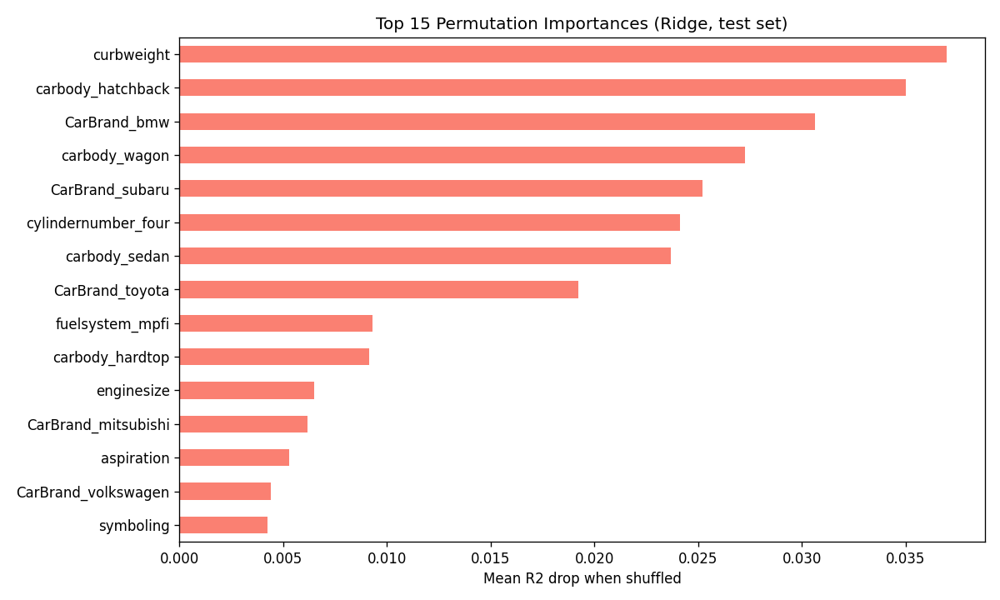
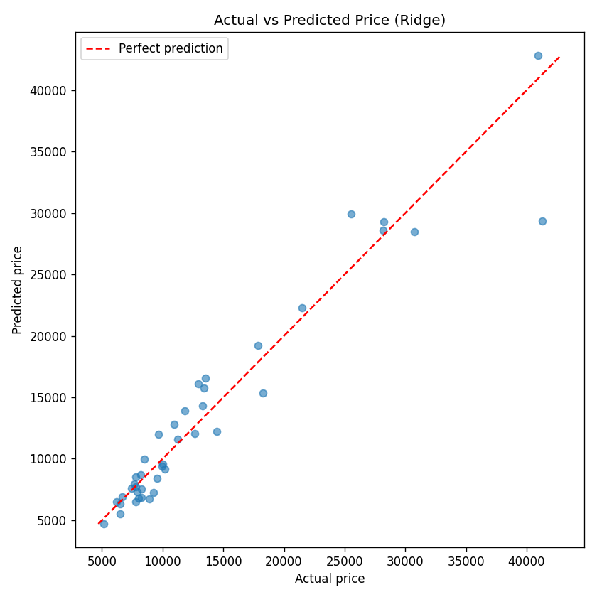

# Car Price Prediction

Predicting the list price of cars from their specifications, using a regularised linear model that beat tree-based ensembles on this small dataset. The project covers exploratory analysis, a leakage-safe modelling pipeline, hyperparameter search, and an honest estimate of out-of-sample error.

## Key results

| Metric (30 repeated random 80/20 splits) | Mean | Std |
|---|---|---|
| R² | 0.920 | 0.028 |
| MAE | $1,586 | $283 |
| RMSE | $2,346 | $519 |

**Winning model: Ridge regression (α = 1.0)** on a log-transformed target, with one-hot encoded categoricals and min-max scaled numerics.

Model selection used 5-fold cross-validated R² on the **dollar scale**, the same metric reported at the end:

| Model | CV R² (dollars) |
|---|---|
| Ridge | 0.905 |
| Lasso | 0.903 |
| Gradient Boosting | 0.894 |
| XGBoost | 0.892 |
| Random Forest | 0.887 |
| Decision Tree | 0.854 |
| Linear Regression (no regularisation) | 0.609 |

With only 205 rows, the regularised linear model generalised better than the more flexible ensembles. The gap between Ridge and XGBoost is small, so the ranking should be read as "comparable, with Ridge simplest and most stable", not as a decisive win.

### Most important features

Permutation importance on the test set (drop in R² when a feature is shuffled):

1. `CarBrand`, by a wide margin
2. `curbweight`
3. `cylindernumber`
4. `enginesize`

`symboling` (the insurance risk rating) contributes almost nothing once the other features are present.





## Method

1. **Data.** 205 cars and 26 columns from `CarPrice_Assignment.csv`. The data has no missing values.
2. **Target.** Price is modelled as `log1p(price)` and predictions are back-transformed with `expm1`. A Duan smearing factor corrects the downward bias that the back-transform introduces.
3. **Pipeline.** Rare car brands are grouped by a custom `RareBrandGrouper` transformer. Encoding and scaling sit in a `ColumnTransformer` with `OneHotEncoder(handle_unknown="ignore")`, all inside one `Pipeline`. This means encoders are fit inside each CV fold, so there is no leakage from the validation data, and an unseen brand at prediction time produces zeroed dummy columns instead of an error.
4. **Model selection.** Each candidate is tuned with `GridSearchCV`, then the winner is refit and evaluated across 30 repeated splits to report a confidence range rather than a single lucky number.
5. **Persistence.** The fitted pipeline is saved to `best_model_pipeline.joblib`.

## Repository contents

| File | Purpose |
|---|---|
| `car_price_prediction_v2.py` | Final, reproducible pipeline: model comparison, repeated-split evaluation, plots, saved model |
| `REVIEW_FINDINGS.md` | Code review of v2: methodology issues found and how they were fixed |
| `car_price_prediction_original.py` | First-pass script (XGBoost-focused, superseded by v2) |
| `Car Price Prediction Project.ipynb` | Exploratory notebook with EDA and the first XGBoost model |
| `CarPrice_Assignment.csv` | Dataset |
| `model_comparison_results.csv` | Cross-validated R² for each candidate model, with best hyperparameters |
| `repeated_split_scores.csv` | R², MAE and RMSE for each of the 30 repeated splits |
| `best_model_pipeline.joblib` | Persisted fitted pipeline |

## Reproduce

```bash
pip install pandas numpy scikit-learn xgboost matplotlib joblib
python car_price_prediction_v2.py
```

The script reads `CarPrice_Assignment.csv` from the current directory and writes the plots, CSVs and model file listed above.

## Limitations

- 205 rows is small. The repeated-split standard deviation (about $280 MAE) is a reminder that individual predictions carry substantial uncertainty.
- The data is a snapshot of cars and prices; it does not capture current market conditions, options packages, or regional pricing.
- Results describe prediction accuracy on this dataset, not causal effects of any feature on price.
